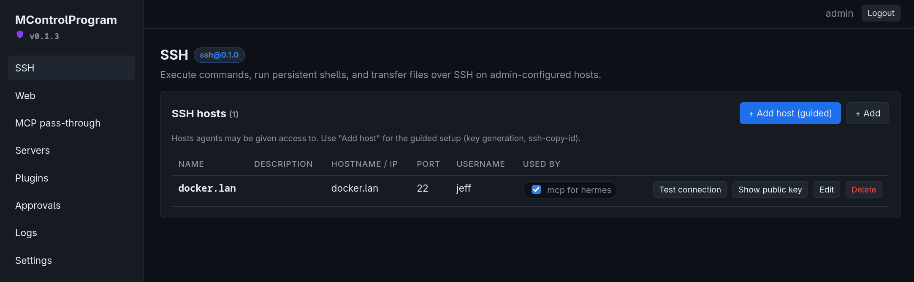

# MControlProgram — MCP gateway with a plugin architecture

MControlProgram sits between AI agents and the things you don't want them to hold directly: SSH keys,
API tokens, internal networks. Agents connect to MControlProgram over the standard
[Model Context Protocol](https://modelcontextprotocol.io) (Streamable HTTP) and get **tools**;
MControlProgram's plugins own the credentials, make the real connections, and enforce policy.



```
 agent (Claude Code, Cursor, …)  ──MCP/HTTP + auth──▶  MControlProgram MCP server :7801  ──▶  ssh plugin ──▶ hosts
 agent                            ──MCP/HTTP + auth──▶  MControlProgram MCP server :7802  ──▶  web plugin ──▶ APIs
                                                              ▲
                                             admin UI :7700 ──┘  (servers, plugins, tokens, logs)
```

- **Multiple MCP servers**, each on its own port with its own plugins, auth mode, and log level.
- **Standard MCP auth**: static bearer tokens and/or full OAuth 2.1 (discovery, dynamic client
  registration, PKCE, refresh, revocation) with an admin consent page. Works with Claude Code,
  Claude Desktop, Cursor and any spec-compliant client.
- **Plugins** define a plugin-wide config (shared inventory such as SSH hosts or web credentials,
  edited from the Plugins page with plugin-provided actions and wizards) plus a per-instance config
  (what each MCP server exposes and how). Built-in:
  `ssh` (exec, persistent shells, SFTP, per-host command allow/deny) and `web` (HTTP requests,
  page-to-text, URL allow/deny, private-network blocking, server-side credential injection,
  isolated cookie jars).
- **Secrets encrypted at rest** (AES-256-GCM, key in `MCONTROLPROGRAM_MASTER_KEY` or `data/master.key`);
  the UI never returns a stored secret.
- **First-run setup**: no default credentials. The first visit to the admin UI asks you to create
  the admin account (or set `MCONTROLPROGRAM_ADMIN_USER`/`MCONTROLPROGRAM_ADMIN_PASSWORD` for unattended installs).
- **Logging** per server: `off`, `connections`, `tools`, `full` (args + results). Persisted to SQLite,
  searchable and live-tailed in the UI.

## Quick start

```bash
npm install
npm run build:web          # one-time; builds the admin UI into web/dist
npm run dev
# open http://127.0.0.1:7700 and complete the one-time setup page (create the admin account)
```

Production: `npm run build && npm start` (serves `dist/main.js`; set env from `.env.example`).

## Docker

```bash
docker compose up -d --build
```

Admin UI on http://localhost:7700. All state (SQLite DB, `master.key`, drop-in plugins) lives in the
`mcontrolprogram-data` volume mounted at `/data`. Add a `ports:` line in `docker-compose.yml` for each MCP
server port you create, and bind the server to `0.0.0.0` in its settings.

## Set up a server for an agent

1. **Plugins → SSH → Configure → Add host (guided)**: name, address, user, then choose key or
   password auth. For keys, MControlProgram can generate the pair (the private key never leaves the server)
   and either install the public key for you with a one-time password (like `ssh-copy-id`) or show
   the exact `authorized_keys` line and where it goes. "Test connection" confirms it works.
   Per-host command allow/deny regexes and SFTP root live here too.
2. **Servers → New server**: name `ops`, port `7801`, auth `bearer` (or `oauth` / `both`), log level `tools`.
3. **Server → Plugins tab → Add plugin → ssh**: tick the hosts from the inventory this server
   should expose (empty = all), pick shell isolation. Save. The instance starts immediately.
4. **Access tab → New token**: copy the token (shown once).
5. In the agent:
   ```bash
   claude mcp add --transport http ops http://127.0.0.1:7801/mcp --header "Authorization: Bearer gdn_…"
   ```
   or with OAuth (`auth_mode: oauth`), just `claude mcp add --transport http ops http://127.0.0.1:7801/mcp`;
   the client will discover the authorization server, register itself, and open the consent page
   where you log in as the MControlProgram admin and approve it.
6. The agent now sees `ssh_list_hosts`, `ssh_exec`, `ssh_shell_send`, … and never the key. Every tool call is self-contained: shells are addressed by `host` + `name` and open on demand, so calls don't depend on order.

Tools are named `<instance name>_<tool>`, so two `ssh` instances named `prod` and `staging` on one
server give `prod_exec` and `staging_exec`.

## Proxying external MCP servers

The built-in `mcp` plugin connects to other MCP servers and re-exposes their tools, so one
MControlProgram endpoint can front many upstreams with a single login, one log, and the approval gate.
Configure upstreams on the Plugins page: Streamable HTTP (none / bearer / custom header / OAuth
2.1 with dynamic registration) or stdio (command, args, env). Secrets such as tokens and env
values are stored encrypted and never leave MControlProgram; the agent sees only the tools. An instance
picks which upstreams to expose, optionally flattens names, and can allow or deny individual tools.
Upstream input schemas and annotations pass through unchanged, so "approve tools that are not
read-only" works on proxied tools too. For OAuth upstreams, run **Authorize (OAuth)** in the plugin
config and open the link; set `MCONTROLPROGRAM_PUBLIC_URL` if the authorization server must redirect to a
public address.

## Human approval for risky tools

Each plugin instance has an approval policy: **never**, **tools that are not read-only** (anything
without `readOnlyHint`), **every tool**, or an explicit list. A gated call is queued on the
**Approvals** page, where you see the tool, caller, and full arguments and can approve or deny.

The agent is never left hanging: the call blocks for *approval wait* seconds (default 30), then
returns an error telling it to wait and call again with the same arguments. Identical retries attach
to the same request rather than creating duplicates. After *max attempts* (default 3) the error tells
the agent to pause and ask the user. An approval is consumed by exactly one execution; a denial sticks
for the request's lifetime (default 1 day). All three knobs live in Settings.

## Writing your own plugin

A plugin is an ES module that adds tools to an MCP server. It runs in-process and is trusted code.
Full reference: [docs/PLUGINS.md](docs/PLUGINS.md); a working copy of the example below lives in
[examples/echo-plugin](examples/echo-plugin).

**1. Create the plugin** at `data/plugins/hello/index.js` (with Docker, `data/` is the `/data` volume):

```js
import { z } from 'zod';

export default {
  id: 'hello',                      // [a-z][a-z0-9_-]*
  name: 'Hello',
  version: '0.1.0',
  description: 'Greets people.',
  // JSON Schema -> the per-instance config form in the UI.
  // "x-secret": true fields are encrypted at rest and never shown again.
  configSchema: {
    type: 'object',
    properties: {
      greeting: { type: 'string', title: 'Greeting', default: 'Hello' },
      apiKey: { type: 'string', title: 'API key', 'x-secret': true },
    },
  },
  defaultConfig: { greeting: 'Hello' },

  // Called once per plugin instance (this plugin added to one MCP server).
  create(ctx) {                     // ctx.config = decrypted instance config, ctx.log = logger
    return {
      start() {},                   // open pools, timers
      stop() {},                    // MUST release everything; runs on reconfigure/stop
      status: () => ({ ok: true }), // shown in the UI
      tools: [{
        name: 'greet',              // exposed to agents as `<instance name>_greet`
        description: 'Greet someone by name.',
        inputSchema: { name: z.string() },          // zod raw shape
        annotations: { readOnlyHint: true },        // lets the approval policy skip it
        async handler({ name }, call) {             // call: { sessionId, principal, signal, log }
          return { content: [{ type: 'text', text: `${ctx.config.greeting}, ${name}!` }] };
        },
      }],
    };
  },
};
```

**2. Load it.** Click **Plugins → Reload plugins**. Plugins are discovered from, in order:
built-ins (`src/plugins`), `data/plugins/<dir>/` (a `package.json` with `main`, or `index.js`),
directories in `MCONTROLPROGRAM_PLUGIN_DIRS` (colon separated), and npm package names listed under
**Plugins → npm packages**.

**3. Use it.** On a server's **Plugins** tab choose **Add plugin → hello**, fill in the config and
save. The instance starts immediately and connected agents get a `tools/list_changed`.

Things worth knowing before you write a real one:

- **Make every tool call self-contained.** Agents retry, parallelise and reconnect, so do not require
  "open, then use the handle" sequences. Address state by stable names, open on demand, make close
  idempotent, and scope state to `call.principal` so agents cannot touch each other's state.
- **Shared inventory.** Put credentials or host lists in `globalConfigSchema` (edited once on the
  Plugins page); instances pick from them with `"x-options-from"`. `globalActions` add buttons or
  wizards that run server-side.
- **Clean up.** Reap idle state from a timer started in `start()` and cleared in `stop()`, and drop
  per-session state in `onSessionClosed`. Use `ctx.global()` for the gateway-wide idle timeouts.
- **Errors.** Throwing from a handler becomes an `isError` result and is logged.
- **Approvals.** Set `readOnlyHint` on tools that change nothing; the gateway handles the rest.

## Layout

```
src/core      config, sqlite, crypto, logger, secrets, plugin API + loader, store
src/mcp       runtime (one Express app + MCP sessions per server), OAuth provider, manager
src/plugins   built-in ssh, web and mcp plugins
src/admin     REST API for the UI
web/          Vite + React admin UI
test/         node:test unit tests (npm test); npm run test:ssh runs live ssh tests against a throwaway sshd
```

## Security notes

- Bind MCP servers to `127.0.0.1` unless you terminate TLS in front of MControlProgram; set `public_url`
  (https) on the server so OAuth metadata advertises the right issuer.
- Bearer tokens and OAuth tokens are stored hashed. The master key file is `0600`; back it up with
  the database or stored secrets are unrecoverable.
- SSH shells are isolated per principal by default (`shellScope: principal`): agents using different
  tokens/OAuth clients cannot see or touch each other's shells, and an agent that reconnects with the
  same token resumes its own. `session` ties shells to the MCP session; `shared` makes them common.
  Two agents sharing one token are one principal, so give each agent its own token.
- Cleanup is automatic and independent of agent behaviour, driven by two MControlProgram-wide defaults in
  **Settings**: *agent state idle timeout* (default 2 days; shells, cookie jars) and *connection idle
  timeout* (default 1 hour; the SSH socket closes but shells survive until the state timeout and the
  socket reopens on the next call). Each plugin instance may override either with its own value;
  `0` means inherit. Session-scoped state also dies when the MCP session ends.
- The `web` plugin keeps a cookie jar per scope (`cookieScope`, default `principal`), so logged-in
  browsing works but agents never see cookie values, cannot inject their own, and cannot reach each
  other's jars. Jars idle longer than the global state timeout (or the instance's `cookieIdleSec`) are discarded; `cookies: false`
  makes every request stateless.
- `web` blocks private/loopback targets by default; the ssh `denyCommands` list is checked on
  `exec` and on every `shell_send` (set `raw: true` only for keystrokes).

## License

[MIT](LICENSE)
